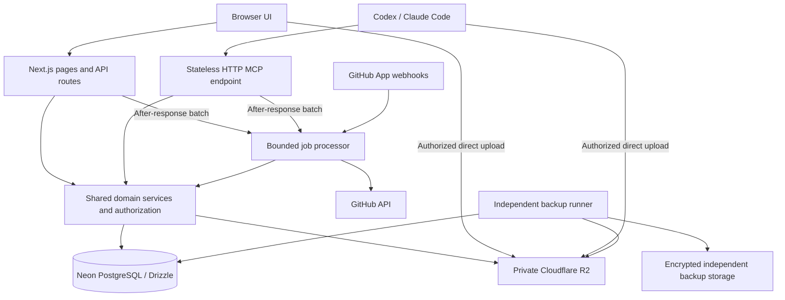

# Architecture and operations

Status: proposed implementation of the accepted product. No infrastructure has been provisioned.

## Application boundaries



- One Next.js App Router application, TypeScript, Node runtime, Vercel Hobby (Pro only if limits or commercial use require it). Avoid Edge-runtime constraints for authentication, PostgreSQL transactions, uploads, and SDK compatibility.
- Server Components perform authenticated initial reads. Interactive views use client components and a small server-state layer; browser mutations call versioned API routes.
- API and MCP adapters validate input and construct an actor; both call the same domain services. MCP does not loop back through public HTTP routes.
- Services own authorization, invariants, transactions, optimistic concurrency, activity, and idempotency. UI hiding is not authorization.
- Drizzle owns the SQL schema and committed migrations. Use a small pg pool with Neon's pooled connection string for the application and Vercel's documented pool lifecycle integration. Use an unpooled connection for migrations/backups where required.
- Avoid microservices, Redis, a separate search engine, or realtime infrastructure until a measured need arises.

Suggested source layout:

```text
src/app/                    routes, pages, layouts, auth and MCP handlers
src/components/             shadcn primitives and domain UI
src/features/               projects, sections, tasks, notes, search, settings
src/server/auth/            Better Auth, owner provisioning, actor construction
src/server/services/        shared product operations and policy checks
src/server/db/              Drizzle schema, queries, transaction helpers
src/server/integrations/    GitHub and R2 adapters
src/server/jobs/            GitHub reconciliation, exports, cleanup, retry handlers
src/server/mcp/             tools and protocol adapter
src/lib/contracts/          shared Zod input/output contracts
drizzle/                    reviewed SQL migrations
```

## Human authentication

- Better Auth with its Drizzle PostgreSQL adapter and GitHub social provider. No public email/password signup or additional social providers.
- Controlled first-owner provisioning validates the immutable GitHub account ID. Then disable public implicit social signup. Recheck owner identity during authentication and authorization; a frontend email check is insufficient.
- Use separate GitHub OAuth application credentials for human login and GitHub App installation credentials for repository integration.
- Browser sessions use HTTPS-only secure cookies and normal CSRF/origin protections. App routes enforce owner authorization. GitHub callback, webhook, and MCP routes use their own appropriate verification mechanisms.
- Keep provider secrets, API-key hashes, installation tokens, and signing keys server-side. Never include them in activity, exports, client props, or logs.
- Better Auth's API-key plugin verifies agent keys. Do not turn an API key into an unrestricted owner browser session.

## Agent access

- `/api/mcp`: stateless Streamable HTTP through Vercel's compatible MCP handler and official SDK. No legacy SSE/Redis design.
- Require `Authorization: Bearer <key>`. Verification produces a stable credential actor, action scopes, and allowed project IDs.
- Owner-only settings issue/revoke keys and alter grants. Show a new secret once; store only the plugin's protected representation.
- Default expiry 90 days. Revocation/grant changes take effect on subsequent authenticated requests; avoid long-lived permission caches.
- This private explicit-key endpoint is not advertised as a complete OAuth MCP authorization server. Document client configuration clearly.
- Long-running software implementation stays local. Remote tools perform bounded project/task operations, not shell execution or arbitrary network access.

## Data integrity and concurrency

- Transactions cover entity mutation, relationship validation, activity, and durable work enqueueing.
- Updates take an expected revision. Atomic UPDATE ... WHERE revision = expected_revision increments it; a mismatch returns conflict and current metadata without erasing the attempted draft.
- Hierarchy/dependency operations lock the affected project's structural guard before checking and writing, avoiding concurrent cycles. Do not hold a database lock across a GitHub/R2 request.
- Credential scopes and project grants are checked again inside the service; all query/count/search branches scope to the owner.
- Idempotency keys bind actor + operation + input fingerprint. Successful retried creates return the prior result; changed input with the same key is rejected. Operational default retention: 24 hours; clients must not assume unlimited retry deduplication.
- Do not expose direct database credentials to agents or browser clients.

## Private R2 storage

1. An authorized caller selects the target, original name, size, and declared MIME type. Validate allowlist and 20,000,000-byte cap; create pending attachment and a random immutable object key.
2. Issue a ten-minute presigned PUT for that key with the required signed content type, declared content length and conditional `If-None-Match: *` header. Configure CORS only for approved app origins/headers; agents send the same required headers.
3. Client/agent uploads directly to R2. Do not send binary/base64 content through MCP or a normal app function.
4. An authenticated finalize call checks ownership and performs HEAD plus limited content inspection. Verify actual size, signature/text encoding where applicable, and metadata; transition to ready only on success. R2 enforcement of signed content length requires provider verification; finalization still rejects and cleans oversized bytes.
5. Downloads first authorize the ready attachment and issue a five-minute GET URL with safe disposition/filename. Serve potentially active content as downloads. No public bucket or custom public delivery domain.
6. Abandoned uploads are removed after URL expiry and a cleanup margin; ensure a reusable old URL cannot overwrite verified bytes. Deletion is retryable and idempotent.

External image links in imported issue bodies remain links; do not silently proxy arbitrary URLs. Optional image display must use safe explicit sources. Attachment content is not searchable in V1.

## GitHub integration and on-demand refresh

- A GitHub App requests only metadata, issues, pull requests, checks, and commit statuses read permissions. No content/write/administration permissions unless later justified. Install on selected personal/organization repositories.
- Organization administrators may restrict installation; show unavailable repositories rather than bypassing their policies.
- Cache linked issue/PR state and relevant head-SHA check summaries in Neon. Fetch selectable import candidates on demand. Never crawl all issues in every account.
- No scheduled cron and no browser polling by default. Freshness is demand-driven: screens read Zenshin's own API and refetch on load, navigation and tab focus (TanStack Query defaults), plus manual Refresh. They never call GitHub directly. A slow TanStack Query `refetchInterval` may be added later to specific screens if live watching proves necessary.
- Refresh-if-stale lives in the shared service, not in components: any read of tracked GitHub data (page load, refetch, MCP read) enqueues/coalesces reconciliation when cached data is older than 60 seconds, then returns cached data with its freshness state. Agents therefore get fresh data while the owner is away.
- Fetch tracked items and repository accessibility with conditional requests. Serialize bounded requests per installation, respect primary/secondary limits and Retry-After/reset headers, and apply exponential retry with jitter. Preserve cached results on transient failures and mark them stale.
- Signed webhooks enqueue the same reconciliation path, deduplicated by delivery ID. Acknowledge after durable enqueue within GitHub's response window. Stale-on-read refresh repairs missed events the next time the data is viewed or read.
- Manual Refresh requests immediate reconciliation, coalesces concurrent refreshes, and remains subject to GitHub limits. It does not create a separate bypass.
- Reconciliation checks remote timestamps/revisions before overwriting cached state and evaluates opt-in transitions atomically against the task's current status. Repeated webhook/stale-on-read/manual results do not repeat transitions/activity.
- Persist import provenance independently from removable task links. Persist rule baselines and processed-event fingerprints; link/enable actions do not replay historical PR events.
- Display Last refreshed, Refreshing, Stale, and Connection unavailable. Freshness is guaranteed only while data is being viewed or read; nothing refreshes while the app is unused.

## Durable work

Use Neon-backed job records for GitHub reconciliation, exports, cleanup, and external deletion retries. Handlers have bounded batches, leases, attempt counts, deduplication keys, next-attempt times, and visible terminal error state. No cron drives the worker: after each app/MCP request, Next.js `after()` processes a small time-boxed batch of due jobs; a screen awaiting a job (for example an export) shows its state and advances it on each refetch or Refresh. Claims use short leases, so overlapping triggers cannot duplicate work and a crashed run is retried by the next trigger after its lease expires. Consequence: cleanup and retries wait while the app is unused; this is accepted for a single-owner tool. Do not rely on in-memory queues or unawaited promises after a request returns; `after()` is the platform-supported way to extend the request, and every job it runs is already durable in the jobs table.

If future needs require work while the app is unused, replace its execution adapter with a managed queue without moving domain logic out of services. This is not a V1 requirement.

## Exports and recovery

- Owner export is asynchronous: JSON domain records with schema version, Markdown notes plus canonical note JSON, task references, relationship IDs, and an attachment manifest. No sessions, API keys, OAuth tokens, app secrets, or backup secrets.
- Store export artifacts privately, issue authorized short-lived download links, and expire artifacts after 24 hours by default. Manifest-only exports do not replace file backups. Import UI is deferred; test a documented recovery script against the export format.
- Configure a paid Neon plan/history setting supporting seven days of point-in-time recovery. Verify the actual configured window rather than assuming the plan name establishes it.
- Proposed independent backup destination: an AWS S3 bucket controlled with credentials separate from application/R2 credentials. Encrypt snapshots and copied attachments, block public access, retain 30 days, and limit destructive privileges. A separate provider reduces a single-account failure boundary.
- Backup runner: a separately scheduled job with a compatible pg_dump binary and unpooled database connection, twice daily. A private GitHub Actions workflow is a practical default runner; its best-effort schedule needs backup-age monitoring and alerting. Do not assume Vercel's runtime contains PostgreSQL utilities.
- Incrementally copy every ready attachment to backup storage; retain source-deleted copies through the recovery window. Snapshot manifests identify needed immutable object keys. Database snapshots must not claim recoverability until all referenced bytes are present.
- Target RPO <=24 hours for complete database-plus-files recovery. Monitor age of the last fully recoverable backup and backup failures; prove a restore before launch and repeat quarterly. Recovery completion time is measured in the drill, not promised without evidence.
- Note revisions and local drafts are convenience recovery, not infrastructure backups. R2's lack of S3 versioning makes explicit attachment backups necessary.

## Deployment and operations

- Separate development/preview/production databases, R2 buckets or tightly separated prefixes, OAuth apps/callbacks, and credentials. Previews must not attach to production repositories or trigger production automations by default.
- Keep app and Neon regions near each other; choose supported regions during provisioning based on latency from India. R2 remains a separate object service.
- CI performs typecheck, lint, meaningful tests, and production build. Production deploy follows a reviewed backward-compatible migration step; never auto-push a schema at app startup.
- Structured logs contain request/credential identifiers and errors without secrets or note contents. Operational signals: auth failures, failed mutations/jobs, GitHub stale age/rate limits, database errors, orphaned uploads, backup age.
- Owner operational alerts are distinct from deferred in-product task notifications. Provider alerts and backup-failure email are sufficient initially; no notification product is required.
- Roll back app code only when compatible with the current schema; prefer forward database fixes. Back up and document any destructive migration first.

## Verified reference sources

- [Better Auth API keys](https://better-auth.com/docs/plugins/api-key), [GitHub provider](https://better-auth.com/docs/authentication/github), [hooks](https://better-auth.com/docs/concepts/database#database-hooks).
- [Vercel MCP](https://vercel.com/docs/mcp/deploy-mcp-servers-to-vercel), [handler protocol support](https://github.com/vercel-labs/mcp-handler#protocol-support), [MCP authorization](https://modelcontextprotocol.io/specification/2026-07-28/basic/authorization).
- [Drizzle Neon drivers](https://orm.drizzle.team/docs/connect-neon), [Vercel pooling](https://vercel.com/kb/guide/connection-pooling-with-functions).
- [Next.js `after()`](https://nextjs.org/docs/app/api-reference/functions/after), [TanStack Query refetch options](https://tanstack.com/query/latest/docs/framework/react/reference/useQuery).
- [GitHub webhook practices](https://docs.github.com/en/webhooks/using-webhooks/best-practices-for-using-webhooks), [API practices](https://docs.github.com/en/rest/using-the-rest-api/best-practices-for-using-the-rest-api), [rate limits](https://docs.github.com/en/rest/using-the-rest-api/rate-limits-for-the-rest-api).
- [R2 presigned URLs](https://developers.cloudflare.com/r2/api/s3/presigned-urls/), [conditional operations/API support](https://developers.cloudflare.com/r2/api/s3/api/), [CORS](https://developers.cloudflare.com/r2/buckets/cors/).
- [Neon history](https://neon.com/docs/postgres/backup-restore/history-window), [pg_dump backups](https://neon.com/docs/manage/backup-pg-dump).
- [S3 encryption](https://docs.aws.amazon.com/AmazonS3/latest/userguide/UsingServerSideEncryption.html), [GitHub Actions schedule behavior](https://docs.github.com/en/actions/reference/workflows-and-actions/events-that-trigger-workflows#schedule).
